# Awesome Load Testing 🚀

  

  
  
  
  
  
  

---

## ⚡ Top Load Testing & Performance Engineering Ecosystem

> A comprehensive, SEO-optimized, community-curated catalog of **SaaS platforms** and **open-source developer tools** for load testing, stress testing, high-concurrency synthetic traffic generation, API benchmarking, and distributed performance engineering.

Whether you are preparing for massive retail peak events (Black Friday / Cyber Monday), stress-testing microservices architectures across gRPC and WebSockets, or automating performance regression tests directly inside CI/CD deployment pipelines, this guide tracks the premier hosted and self-hosted tools available today.

* **High-Concurrency Load Generators**: Generate millions of requests per second across multi-core machines or distributed injector clusters.
* **Protocol & Transport Coverage**: HTTP/1.1, HTTP/2, HTTP/3, WebSockets, gRPC, MQTT, JDBC, and headless browser automation (Playwright/Puppeteer).
* **SLO Validation & Gating**: Automated pass/fail thresholds, p90/p95/p99 latency percentiles, error budget tracking, and real-time APM telemetry.

---

## 📑 Table of Contents

- [🌐 Sector Overview & Market Dynamics](#-sector-overview--market-dynamics)
- [🏢 SaaS & Hosted Testing Platforms](#-saas--hosted-testing-platforms)
- [💻 Open-Source GitHub Projects](#-open-source-github-projects)
- [🤝 How to Contribute](#-how-to-contribute)
- [💖 Support & Sponsorship](#-support--sponsorship)
- [📈 Star History](#-star-history)
- [⚖️ Disclaimer](#️-disclaimer)

---

## 🌐 Sector Overview & Market Dynamics

The global load and performance testing software market is valued at approximately **$1.4B–$1.7B** and projected to expand to **$4.0B–$5.5B** by the mid-2030s (~10%–16% CAGR). Growth is driven by rapid cloud migration, microservices architecture adoption, mission-critical uptime requirements, and the imperative to shift performance validation left into CI/CD continuous deployment pipelines.

The sector is **moderately fragmented** rather than winner-take-all:
* **Legacy Enterprise Suites** (such as OpenText LoadRunner and Tricentis NeoLoad) maintain strong multi-protocol enterprise footprints across traditional financial and telecommunication systems.
* **Modern Cloud-Native Observability Providers** (such as Grafana Labs with k6 Cloud) integrate load generation directly into metrics, logs, and trace dashboards.
* **Specialized Continuous Testing SaaS Platforms** (like BlazeMeter, Gatling Enterprise, and OctoPerf) offer dedicated managed infrastructure without vendor lock-in.
* **Vibrant Open-Source Ecosystems** (k6, wrk, Locust, JMeter, Vegeta, hey, and oha) dominate grassroots developer adoption and CI/CD runners worldwide.

---

## 🏢 SaaS & Hosted Testing Platforms

| Platform | Company Scale / Valuation / Revenue | Starting Price | Free Tier / Trial Limits | Description |
| :--- | :--- | :--- | :--- | :--- |
| **[Loader.io](https://loader.io/)** | **Twilio / SendGrid** • Market Cap: ~$37.5B–$39.5B • Twilio Revenue: ~$5.07B–$5.57B | **$99.95/mo** (Pro plan) | **Free forever plan**: Up to 10,000 clients/test, 1 test at a time, max 1 minute test duration, 2 URLs per test, single US-East datacenter. | Lightweight cloud-based load testing utility focused on rapid HTTP endpoint and API stress testing with minimal configuration. |
| **[LoadRunner Cloud](https://www.opentext.com/)** | **OpenText** • Market Cap: ~$7.5B–$8.2B • FY Revenue: ~$5.17B–$5.77B | **~$0.15–$0.50 / VUH** (~$10,000+/yr enterprise entry) | **30-day free trial**: 1,000 GUI Virtual User Hours (VUHs), max 1 concurrent test, 1-hour max duration, max 100 Web / 30 GUI / 100 Dev Vusers, capped at 10 total test runs. | Enterprise performance testing powerhouse with deep multi-protocol support, automated SLA validation, and enterprise-scale cloud injection. |
| **[k6 Cloud](https://grafana.com/products/cloud/k6/)** | **Grafana Labs** • Valuation: $6.0B • ARR: ~$400M–$500M+ | **$19/mo** (Grafana Cloud Pro platform fee + $0.15/additional VUH) | **Free forever tier**: 500 Virtual User Hours (VUH)/month included, 14-day test result retention, and community support (no credit card required). | Managed distributed execution and collaborative analytics for k6 test scripts, deeply integrated with Grafana's observability ecosystem. |
| **[NeoLoad](https://www.tricentis.com/)** | **Tricentis** • Valuation: $4.5B • ARR: ~$425M–$500M | **~$20,000/yr** (Enterprise entry license quote) | **14-day free trial**: Access to AI-driven test design, codeless script authoring, and cloud/on-prem test controllers with test duration/VU caps. | Continuous enterprise performance testing platform designed for Agile and DevOps teams with low-code script design and broad protocol coverage. |
| **[BlazeMeter](https://www.blazemeter.com/)** | **Perforce Software** • Revenue: ~$500M–$750M (est.) • Private equity backed (Clearlake / Francisco Partners) | **$99/mo** (billed annually) or **$149/mo** (billed monthly) | **Free Starter plan**: 50 concurrent virtual users, 1 shared load generator, 10 tests/month, 20-minute maximum test duration, and 1,000 API tests/month. | Enterprise continuous testing platform built around Apache JMeter, enabling distributed cloud load generation, mock services, and CI/CD gating. |
| **[Gatling Enterprise](https://gatling.io/)** | **Gatling Corp** • Privately held / Independent SMB (~$5M–$15M est. ARR) | **€89/mo** (~$95/mo, Basic starter cloud pack) | **14-day free trial**: Full access to cloud distributed injectors, real-time metrics dashboards, CI/CD integrations, and AI insights (no credit card required). Core engine is also permanently free and open source. | Commercial distributed execution tier for Gatling test scripts, delivering centralized team reporting, live telemetry, and managed cloud injectors. |
| **[OctoPerf](https://octoperf.com/)** | **OctoPerf** • Privately held / Bootstrapped (~$1M–$5M est. ARR) | **$69–$99/test** (Pay-Per-Test) or **$149/mo** (Cloud subscription) | **Community lifetime free plan**: 50 concurrent virtual users, unlimited tests, 20-minute maximum test duration, 1 parallel run, and full access to platform features. | Full-featured SaaS load testing platform providing a web UI designer for JMeter and Gatling scripts with automated report analysis. |
| **[Flood.io (Tricentis Flood)](https://flood.io/)** | **Tricentis** (Retired product line) • Product reached End of Life (EOL) June 30, 2024 | **Discontinued** (Formerly usage-based / node-hour tiers) | **No active tier / trial**: Product reached End-of-Life on June 30, 2024; active users migrated to Tricentis NeoLoad. | Legacy cloud load testing platform executing JMeter and Gatling scripts; officially retired in favor of NeoLoad. |

---

## 💻 Open-Source GitHub Projects

Sorted descending by GitHub stars, featuring live social star badges linking directly to each repository's stargazers community.

| Tool | GitHub Stars | Core Language / Engine | Primary Use Case & Key Strengths |
| :--- | :--- | :--- | :--- |
| **[wrk](https://github.com/wg/wrk)** |  | C (epoll / kqueue / LuaJIT) | **The raw throughput champion.** High-performance HTTP benchmarking tool capable of generating massive concurrent load from a single multi-core system. Uses non-blocking I/O and LuaJIT for flexible HTTP request body manipulation and custom response scripting. |
| **[k6](https://github.com/grafana/k6)** |  | Go (JavaScript ES6 DSL) | **The modern CI/CD-native standard.** Developer-centric performance testing tool built in Go with familiar JavaScript scripting. Features built-in pass/fail thresholds, rich CLI telemetry, extension modules (xk6), and native protocol support for HTTP, WebSockets, and gRPC. |
| **[Locust](https://github.com/locustio/locust)** |  | Python (gevent async) | **The Python developer's answer.** Define complex user behavior using pure Python code without cumbersome XML or UI designers. Offers an intuitive built-in web UI with live chart updates, real-time user ramp-ups, and native distributed worker orchestration. |
| **[Vegeta](https://github.com/tsenart/vegeta)** |  | Go (CLI & Library) | **The constant-rate benchmarking specialist.** Designed specifically for drilling HTTP services with a sustained, predictable request rate (req/s). Emits detailed latency distribution histograms and functions seamlessly as both a standalone CLI and an importable Go library. |
| **[hey](https://github.com/rakyll/hey)** |  | Go | **Modern ApacheBench (ab) replacement.** Fast, zero-dependency CLI tool for stress testing HTTP/1.1 and HTTP/2 endpoints with clean terminal output, percentile response distribution, and custom request header support. |
| **[oha](https://github.com/hatoo/oha)** |  | Rust (tokio / tui) | **Interactive terminal HTTP benchmarking.** Fast HTTP load generator written in Rust featuring an interactive real-time terminal UI (TUI) with animated latency histograms, request throughput graphs, and HTTP/2 support. |
| **[Apache JMeter](https://github.com/apache/jmeter)** |  | Java | **The protocol-agnostic industry veteran.** Fully featured Java desktop testing platform with two decades of active ecosystem development. Supports almost every protocol in existence (HTTP/S, JDBC, JMS, FTP, LDAP, TCP) with extensive third-party plugins. |
| **[Artillery](https://github.com/artilleryio/artillery)** |  | Node.js (YAML/JS DSL) | **Serverless-native continuous testing.** Cloud-native load testing engine configured via YAML with support for HTTP, WebSockets, Socket.io, and Playwright browser scenarios. Natively deploys serverless injector fleets directly onto AWS Lambda and ECS/Fargate. |
| **[Autocannon](https://github.com/mcollina/autocannon)** |  | JavaScript / Node.js | **Fast Node.js HTTP/1.1 benchmarking.** Capable of saturating local network sockets with HTTP requests, supporting HTTP pipelining, rate limiting, and 100% JavaScript programmability inside Node.js testing suites. |
| **[Ddosify](https://github.com/ddosify/ddosify)** |  | Go | **High-performance multi-protocol engine.** Simple yet robust load generator supporting HTTP, HTTPS, HTTP/2, and gRPC. Features linear, incremental, and waved traffic patterns with distributed execution capabilities. |
| **[Gatling](https://github.com/gatling/gatling)** |  | Scala / Java / Kotlin / TypeScript | **JVM-based DSL with polished HTML reports.** High-performance non-blocking engine built on Akka and Netty. Offers code-first test authoring with version-controlled test assets and produces comprehensive out-of-the-box HTML analytical reports. |
| **[Bombardier](https://github.com/codesenberg/bombardier)** |  | Go (fasthttp) | **Fast cross-platform HTTP benchmarking tool.** Leverages `fasthttp` rather than the Go standard library to achieve extreme throughput with minimal CPU overhead across Windows, macOS, and Linux. |
| **[Siege](https://github.com/JoeDog/siege)** |  | C | **Multi-threaded HTTP/HTTPS regression testing utility.** Allows testing web servers under stress with randomized URL hits from file lists, cookie support, and transaction logging. |
| **[wrk2](https://github.com/giltene/wrk2)** |  | C (LuaJIT) | **Rate-limited load generator with Coordinated Omission correction.** A fork of `wrk` modified to generate a constant request rate while capturing true high-percentile latency (service time + wait time). |
| **[ghz](https://github.com/bojand/ghz)** |  | Go | **Dedicated gRPC benchmarking and load testing tool.** Provides simple CLI invocation and programmatic Go APIs for benchmarking unary, client streaming, server streaming, and bidirectional gRPC calls. |
| **[Drill](https://github.com/fcsonline/drill)** |  | Rust | **Lightweight HTTP load test runner.** Written in Rust with clean YAML test specifications. Compiles to a tiny standalone single binary (~5MB) with zero external runtime dependencies. |
| **[Taurus](https://github.com/Blazemeter/taurus)** |  | Python | **Automation-friendly wrapper for testing engines.** Provides a unified YAML/JSON configuration syntax to orchestrate JMeter, Gatling, Locust, Selenium, and Siege within CI/CD build steps. |

---

## 🤝 How to Contribute

Contributions, tool suggestions, and documentation enhancements are always warmly welcomed! 🌟

1. **Fork** the repository on GitHub.
2. **Create a branch** for your feature or update (`git checkout -b feature/new-tool`).
3. **Add or update entries** in `README.md`:
   - Keep descriptions objective, accurate, and concise.
   - For SaaS additions, provide exact tier pricing and specific free trial/free tier limits.
   - For open-source tools, include the repository URL, core language/engine, and star badge (`style=social&color=white`).
4. **Commit** your changes (`git commit -m "Add NewTool to open-source load testing section"`).
5. **Push** to your branch (`git push origin feature/new-tool`).
6. **Open a Pull Request** with a brief summary of why the tool belongs in this curated collection.

---

## 💖 Support & Sponsorship

If you found **Awesome-Load-Testing** useful for your projects, infrastructure benchmarking, or performance engineering research:

- ⭐ **Star this repository** to help others discover it!
- 🍴 **Fork it** and build your own specialized test suites!
- 📢 **Share it** with colleagues, DevOps communities, and on social media!
- ☕ **Buy me a coffee**: If you'd like to support the ongoing maintenance and curation of open developer resources, consider sponsoring via the [GitHub Sponsor Dashboard](https://github.com/sponsors/ishandutta2007).

Your backing and feedback are deeply appreciated! ❤️

---

## 📈 Star History

---

## ⚖️ Disclaimer

- This is an **independent, community-curated** resource and does not constitute commercial endorsement of any specific product or platform.
- **Select tools based on requirements**:
  - Use **k6** for developer-led, CI/CD automated pipeline thresholds and JavaScript scripting.
  - Use **Locust** when dynamic user simulation requires arbitrary Python libraries and real-time dashboard tuning.
  - Use **Gatling** when JVM ecosystem alignment and out-of-the-box HTML reporting are paramount.
  - Use **wrk** or **Vegeta** when raw endpoint throughput or constant-rate saturation benchmarking is required.
  - Use **JMeter** when multi-protocol validation across non-HTTP legacy architectures is required.
- **Infrastructure Overhead**: While open-source tools are freely available, distributed high-concurrency test generation requires provisioning and maintaining injector fleets; SaaS platforms provide managed infrastructure to eliminate that operational workload.

---

  <b>Built for performance engineers, DevOps teams, SREs, and developers who build resilient systems.</b> 
  Maintained by <a href="https://github.com/ishandutta2007">Ishan Dutta</a> · Contributions welcome!

